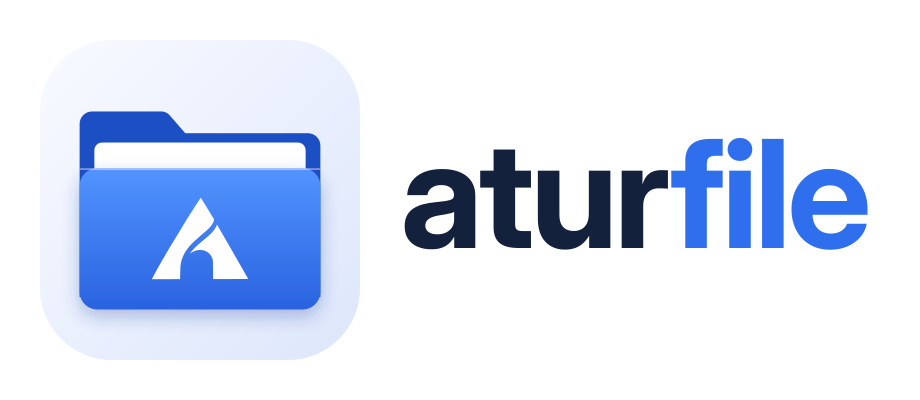

<picture>
  <source media="(prefers-color-scheme: dark)" srcset="docs/brand/wordmark-dark.png">
  
</picture>

# aturfile

A fast file manager for macOS with disk cleanup built in. Rust and GPUI.

The core is open source (GPL-3.0-or-later). A paid Pro build is sold on the
Mac App Store and as a direct download (one-time licence, one year of updates).

## Layout

```
crates/af-fs     folder listing (parallel stat, natural sort, type-to-filter),
                 file kinds, multi-selection, location parsing, preview reads,
                 file operations with undo (conflict names, copy, move)
crates/af-mac    macOS glue: real home, Finder Trash, sandbox folder grants,
                 mounted volumes and free space
crates/af-clean  cleanup engine: parallel scanner, System Data report,
                 staged queue with protected-path guards, duplicates
crates/af-search file-name index (bounded, background) and fuzzy ranking
crates/af-store  Pro unlock through StoreKit 2 (feature `store`)
crates/af-ui     design system (from Kantor): palettes, bundled themes,
                 colour tokens, metrics, small components, icons
crates/af-app    the GPUI app (binary `aturfile`), on gpui-kit
```

The app is built on [gpui-kit](https://gpui-kit.com) (GPUI plus GPUI
Component's widgets and the Lucide icons). The window:

- **Title bar** with tabs (each keeps its own folder, history and view) and
  a "Search ⌘K" button.
- **Search** (Cmd-K): file and folder names across Home and mounted volumes,
  indexed on a background thread the first time (`~/Library` and hidden
  folders skipped; at most 10 s and 200,000 items, with a note when results
  are partial). Typing ranks names fuzzily (exact, then prefix, then
  contiguous, with word boundaries counting more); matching commands stay on
  top, and the empty field lists every command. Names only, never contents.
  Tab (or the Files switch) shows commands only; the choice is remembered.
- **Sidebar** (resizable, Cmd-Alt-S): Favorites (standard folders and your
  pins), Locations (mounted volumes with a capacity bar), Tools (Clean Up).
- **Toolbar**: back and forward, a breadcrumb path bar (click a folder to go;
  click empty space or press Cmd-L to type a path, `~` works), the view
  switcher, the filter field and the preview toggle.
- **Views**: List (sortable, resizable columns; folders stay on top when
  sorted by name or kind, while Modified and Size sort everything together), Columns (Miller columns),
  Icons (with image thumbnails). All are virtualised.
- **Drag and drop**: drag items onto a folder, a sidebar place, a column or
  the view's background; drag files in from Finder or out to any app. Like
  Finder, the same disk moves and another disk copies; Option copies,
  Command moves. Undo works as for paste.
- **Preview pane** (resizable, Cmd-Alt-P): images, text and source code,
  rendered Markdown, folder totals, and the item's details.
- **Status bar**: item count, selection count and size, free space, view.

Settings (theme, density, view, panels, pins) live in
`~/Library/Application Support/aturfile/settings.toml` (inside the container
in the App Store build). The theme follows the system's light or dark mode
until you pick one in the palette (Cmd-,).

## Free and Pro

Source and GitHub builds are fully unlocked. The Mac App Store build
(`--features af-app/store`, StoreKit 2 through a small Swift bridge in
`crates/af-store`) sells one Pro unlock: more than one tab, and Clean Up's
Move to Trash. Everything else stays free. Release steps:
[docs/release.md](docs/release.md).

## Builds

GitHub Actions builds everything (`.github/workflows/ci.yml`): the engines
are linted and tested on Linux, and the app is linted, tested, built,
bundled and launched on macOS. Each run uploads `aturfile-macos` (a plain
bundle plus one signed ad hoc with the App Store sandbox entitlements) and
`smoke-screenshots` (every view, both themes, the palette and Clean Up).

```
aturfile [folder] [--cleanup] [--view list|columns|icons] [--preview]
         [--select NAME] [--theme NAME] [--density compact|airy]
         [--palette] [--search QUERY] [--sheet about|pro] [--window WxH]
```

## Keys

| Key | Does |
| --- | --- |
| Up / Down, Home / End, Page Up / Down | Move (Left / Right too in Icons) |
| Shift-click, Shift-arrows | Extend the selection |
| Cmd-click | Add or remove an item |
| Cmd-A | Select all |
| Cmd-Down, Cmd-O, double-click | Open |
| Return | Rename (open the match while filtering) |
| F2 | Rename |
| Left / Right (Columns) | Enclosing folder / into the selected folder |
| Backspace (empty filter), Cmd-Up | Enclosing folder |
| Cmd-[ / Cmd-] | Back / Forward |
| Any letter | Filter this folder |
| Cmd-F | Filter field |
| Escape | Clear the filter, close the palette, cancel editing |
| Cmd-L | Type a location |
| Space | Quick Look |
| Cmd-T / Cmd-W | New tab / close tab |
| Ctrl-Tab, Cmd-Shift-] / Cmd-Shift-[ | Next / previous tab |
| Cmd-1 / Cmd-2 / Cmd-3 | List / Columns / Icons |
| Cmd-Alt-S / Cmd-Alt-P | Sidebar / preview pane |
| Cmd-I | Get Info (shows the preview pane) |
| Cmd-K | Search files by name (empty: commands; Return opens the folder or shows the file in it, Cmd-Return opens it in its app) |
| Cmd-Shift-P | All commands |
| Cmd-, | Theme |
| Cmd-Shift-N | New folder |
| Cmd-D | Duplicate |
| Cmd-C / Cmd-X / Cmd-V | Copy / cut / paste items |
| Cmd-Alt-V | Move the copied items here |
| Cmd-Z / Cmd-Shift-Z | Undo / redo |
| Cmd-Backspace | Move to Trash |
| Cmd-Alt-C | Copy path |
| Cmd-R | Reveal in Finder |
| Cmd-Shift-. | Show hidden files |
| Cmd-Shift-R | Reload (rescan in Clean Up) |
| Cmd-Shift-K | Clean Up |
| Return (Clean Up) | Stage or unstage the selected row |
| Cmd-S (Clean Up) | Stage or unstage the selected row |
| Cmd-Shift-Backspace (Clean Up) | Move the queue to Trash |

On Linux, Cmd is Ctrl. Name conflicts get " 2", " 3". Undoing a copy or a
new folder moves it to the Trash; nothing is deleted outright.

## Contributing

Contributions need a signed contributor licence agreement ([CLA.md](CLA.md)),
so the same code can be sold on the App Store. The CLA bot asks on your first
pull request.
